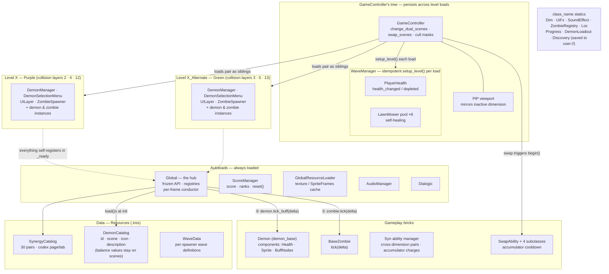

# README.md — Eye of Syn

2D pixel-art, lane/grid tower defense (PvZ-style) in **Godot 4.6 / GDScript**. Project id is
`PVZ0.1` (legacy — demons were once "plants"; the `Plants` group still exists). Core hooks: two
parallel **dimensions** the player swaps between, and a spatial **demon synergy/buff** system.

## Architecture

**`Global` autoload is the hub — and its API is FROZEN (2026-07 refactor rule).** It is the
service-locator + registry for nearly everything (demons, zombies, occulums, portals, syn/swap
abilities, lightning balls, shields, UI layers, demon managers, costs, synergies). Nodes **self-register**
in `_ready` and **deregister** on death/free. Existing call sites keep using `Global`
indefinitely — do not churn them. But **never add new registries, helpers, preloads, or state to
`Global`**: a new system gets its own module (`class_name` statics like `Dim`/`UiFx`/
`SoundEffect`/`ZombieRegistry`, a Resource catalog, or a node) and is referenced directly; files being
rewritten for other reasons migrate to direct module references opportunistically. Other
autoloads: `GlobalResourceLoader`, `AudioManager`, `Dialogic`, `ScoreManager` — do not add more.

**Dual dimension ("Purple" / "Green") is THE core mechanic.** Every level ships as a pair: `LevelX`
(Purple, default) + `LevelX_Alternate` (Green), loaded **simultaneously** as siblings under
GameController's `scene_container`. They are separated by **canvas visibility layers + viewport
cull mask** (`DIM_BITS`), not show/hide; shared UI is bit 0. Each level's tutorial pop-ups
(`ToolTips`) are stamped with `Dim.OVERLAY_BITS` instead, so they draw only in the main view of
their own dimension and are never mirrored into the PiP. Culling is draw-only: a culled but
`visible` Control still takes mouse input, and physics picking reaches both dimensions' areas. `Global.is_on_purple_dimension()`
(== `game_controller.on_scene_1`) is the single source of truth. `swap_scenes()` flips the active
dimension, re-applies cull masks, makes the active `Camera2D` current, and updates the PiP (which
mirrors the *inactive* dimension). Persistent entities are **re-grouped + reparented** into the
active dimension on swap — anything meant to survive a swap must tolerate that.

**Dimension membership is a group, not a field.** Logic branches on `is_in_group("Purple")` /
`"Green"` (and many project-wide groups) far more than on type. Placing a demon auto-places an
invisible **`EmptyDemon` blocker** at the mirrored cell in the other dimension
(`place_empty_in_alt_scene`), so a demon in one dimension blocks its mirror cell in the other.

**Collision layers are a hard convention, assigned in CODE (not just scenes):** 2 = Purple demons ·
3 = Green demons · 4 = Purple zombies · 5 = Green zombies · 12 = Purple buff tiles · 13 = Green
buff tiles. Effect: **same-dimension nodes detect each other; cross-dimension never do, by design**
— this is how the two worlds stay physically isolated inside one scene tree. (`BloodTile` group
lives on the `TileArea` buff zones, not on the visual blood sprites.)

**Demons = `Area2D` + component composition + template-method base.** `Demon` (`demon_base.gd`) is
the base; concrete demons (Occulum, Crawler, Wyrm, Hive, Maw, SpinalOcculum, Heart) extend it and
`super()` into lifecycle hooks (`_ready`, `receive_buff`, `die`/`_cleanup`, `debuff`). Behavior
lives in child components (AnimatedSprite, Health, BuffNodes, PreviewNodes).

**Grid placement via a per-dimension `DemonManager`.** 32px grid; `grid_map: Dictionary` keyed by
**cell-center** (`floor(pos/32)*32 + 16`) → demon. Multi-cell demons write multiple keys (Maw = 2,
Heart = 6). Each dimension has its own DemonManager *and* DemonSelectionMenu.

**Buff/synergy is spatial + polled.** Each demon's BuffNodes component owns `TileArea` zones and
polls `get_overlapping_areas()` in `tick_buff(delta)` — driven by the conductor (below), gated by
`buff_ready` (set after the post-spawn awaits) and `can_process()`. Targets match by **exact
digit-stripped true name** (`get_demon_true_name()`) against the demon's exported `give_buff_to`
list — substring matching is gone. Synergy pair identity + codex navigation live in
`SynergyCatalog.tres` (30 `SynergyDefinition`s); unlock STATE is saved by `Discovery` (see Codex
gating). Synergy ids capitalize only each word's first letter (`"SpinalocculumOcculum"`) so
pairs split on capitals — build them with `SynergyDefinition.make_id()`, never by hand. The
placement preview uses **oldest-overlapping-zone-wins** and hides a zone whose cell is occupied. A
demon scene is previewable only if it contains a node named exactly **`PreviewNodes`** (its
children are duplicated semi-transparent and dragged with the cursor).

**`Global._process` is the per-frame conductor.** Explicit order, one pause gate:
**(1)** every zombie's `tick(delta)`, then **(2)** every demon's `tick_buff(delta)` (BuffNodes
polling) — buffs always react to settled positions. Both loops iterate a *duplicate* of the
registry array with validity guards. Zombies and BuffNodes have no per-frame callbacks of their
own — new per-frame gameplay logic belongs in `tick`/`tick_buff`, added to the conductor in an
explicit position. Syn charges and the swap cooldown keep their own accumulator `_process`; they
touch no cross-system state mid-frame. Zombie types differ by their components/abilities, not
base tick.

**Waves: data resources sequenced by the persistent `WaveManager`.** Per-dimension
`ZombieSpawner`s hold `Array[WaveData]` (`.tres`). `WaveManager` lives under GameController's
`CurrentScene` and **survives level loads** — `change_dual_scenes` re-runs its **idempotent
`setup_level()`** on every load/restart (never invoke `_ready` manually). Player health is its
`PlayerHealth` child node (`max_health` set in WaveManager.tscn; emits
`health_changed`/`depleted`, UILayers subscribe). Lawnmowers are a **self-healing pool**
(`LawnMower.tscn`): `_ensure_lawn_mowers()` re-finds or recreates all six each level, and each
mower stamps itself to its dimension's visibility layer. The spawn pool is **shuffled per wave**
(order is random). Wave previews register with the manager.

**Syn abilities (player-activated) are cross-dimension pairs.** Each cast spawns a Purple + Green
half that self-register; when both are present `Global` **links** them (`connect_syn_abilities` /
`connect_lightning_balls` / `connect_syn_shields`) and draws a cross-dimension connector. Cooldown
is a per-charge **accumulator state machine** (READY/ACTIVE/COOLDOWN) advanced in `_process` by
`delta * rate` — **not** a Timer restart. Two charges (one per dimension) share one UI bar; a charge
recharges **4× faster while the other dimension's charge is deployed**; cooldown **starts when the
deployed instance dies, not at cast**.

**Swap abilities are triggered by the swap itself.** Not player-cast: `GameController.swap_scenes()`
→ `Global.start_swap_ability()` → `swap_ability.begin()`. Named abilities (blood rain, lucretia
grasp, lightning storm, gaze of baal) extend `SwapAbility` and override `apply_swap_ability` /
`undo_swap_ability` / `get_icon`. `begin()` runs **before** `on_scene_1` flips, so an ability must
read `is_on_purple_dimension()` at apply time, not cache the dimension. Cooldown/duration are
**accumulator-driven** like syn (`is_active`/`is_on_cooldown` + counters in `_physics_process`,
no Timer nodes): early cancel → normal cooldown, full duration → −2.5 s special cooldown.

**Swap/Syn bars show only in levels and on the ability panel.** Both live under GameController
and survive scene changes, so visibility is explicit:
- `change_scene` (every menu change) and `change_from_dual_scenes` hide them.
- `ability_control_panel._ready` and `equip_default_sorceries()` (level start) show them.
- `hide_swap_syn()` / `show_swap_syn()` guard on Global's **live** references. GameController's own
  `swap_ability` field goes stale (null at boot, freed when the panel registers a new swap), so
  don't guard on it.
- The Syn button is a fixed 64×64 slot (`syn_ability_cooldown_visual.CARD_SLOT_SIZE`), because the
  card PNGs range from 32 to 64px. Mark scales exactly 2×; Shield, Shroomie and Blood Ice resample
  unevenly until they're re-exported at 64×64.

**Content catalogs are Resources; balance numbers are scene exports.** `DemonCatalog.tres` holds
each placeable demon's identity (id = true name, scene, icon, description path);
`SynergyCatalog.tres` holds the 30 synergy pairs + codex navigation. Adding a demon or synergy is
**data-only** — zero `Global` edits. Costs/HP/timers deliberately **stay on the unit, never the
catalog**: the scene's exports, or its Stats config when one is assigned (see Stat configs).
`get_demon_cost()` → `DemonDefinition.get_scene_cost()` derives the menu label lazily from the
scene with its config applied, so the label and the amount charged can never drift. The Occulum's
escalating price (per dimension) is `Occulum.cost_for_count()`, which the menu label also uses.

**Scoring + style rank.** Each demon accrues `game_time` and reports to `ScoreManager` on the
`level_ended` signal (weighted by whether it was buffed). Per-level threshold arrays (exported on
the level script) map the total to a **style rank**, shown on the end-of-level score screen —
**purple dimension only**.

**Level progression is linear and saved by the `Progress` statics** (`_Utilities/progress.gd`).
The save is `highest_unlocked` plus a `[best_ranks]` section (level → best overall rank, 0 = SSS
… 5 = D) in `user://progress.cfg` (separate from `settings.cfg`). Beating level N unlocks N+1.
An Act is unlocked once its first level is (beat 9 → Act 2, beat 14 → Act 3). Level identity =
the purple scene path's position in `Progress.ACTS`,
which is in **select-screen button order, not folder order** (slot 7 is `Level8.tscn`, slot 8 is
`Level7.tscn`). A new level needs a table entry, or its wins log `[PROGRESS] unknown level` and
aren't recorded. Wins are recorded at one choke point, `WaveManager._win()`, before `level_ended`.
Select screens darken and disable locked entries via `UiFx.set_locked` and expose `refresh_locks()`.
Their sorcery-menu button stays locked until `Progress.any_sorcery_unlocked()`. The win screens'
Next/Continue go to `Progress.select_screen_after_win()`: the Act of the level *after* the one
beaten, so finishing an Act lands on the next one. Demon unlocks are derived from progress (see
Demon loadouts); the Act screens no longer read `Global.*_unlocked`. Zombie and synergy
discoveries are saved separately by `Discovery` (see Codex gating).

**Stars + sorcery unlocks.** The score screen's overall rank is recorded per level
(`style_screen.set_overall_rank` → `Progress.record_rank`; below D counts as D). Stars are
**derived** from each level's best rank (SSS 3, S/A/B 2, C/D 1; max 51) and never stored, so
replays can raise the total but not farm it. Swap/Syn sorceries unlock from `Progress.SORCERY_UNLOCKS`.
Each sorcery either needs a beaten level or a star **threshold**; stars are never spent. The ability
control panel darkens locked ones. Clicking a locked one shows its requirement but doesn't equip it.
The equipped sorceries persist for the session (not saved). Levels 5–17 call
`level_template.equip_default_sorceries()`, which equips Lightning Strike / Lightning Storm only
when nothing is equipped, so a panel pick carries into the level. Never call
`Global.register_*_ability` unconditionally from a level: it overwrites the player's pick.

**Demon loadouts (`DemonLoadout` statics, `_Utilities/demon_loadout.gd`).**
- **Unlocks:** each demon unlocks by beating a level (`Progress.DEMON_UNLOCKS`; Maw = level 11).
- **Act screens:** the `DemonGridContainer` hides locked demons. Once all six are unlocked, the
  player equips 1–5 per dimension (Y flips purple/green). Unequipped icons are darkened, and
  equipping a 6th drops a random one. One state is shared by all Acts and saved to
  `user://loadout.cfg`.
- **In levels:** loadouts apply only from `DemonLoadout.FIRST_LEVEL` (12) on.
  `GameController.change_dual_scenes` calls each dimension menu's
  `DemonSelectionMenu.set_loadout()`. A `visibility_changed` guard re-hides any card outside the
  loadout, whoever shows it. It only **hides**: availability = the level's cards ∩ the loadout,
  so level scripts stay untouched.

**Codex gating (`Discovery` statics, `_Utilities/discovery.gd`).** The codexes show only what the
player has met. Anything else is a jet-black silhouette of its normal art and can't be clicked.
- **Sources of truth:** demons = `Progress.is_demon_unlocked`. Zombies = first real spawn
  (`Global.unlock_zombie`, called from every zombie's `_ready`). Synergies = first trigger
  (`Global.unlock_buff`, connected in all six demon scripts). Zombies and synergies are saved to
  `user://discovery.cfg`. `discover_*` returns true only the first time, so the in-level unlock
  pop-ups fire once per save, not once per session.
- **Look:** `UiFx.set_silhouette` (art `self_modulate` = black + disabled; reverting restores the
  exact normal look). Card frames/backs behind the art use `UiFx.set_locked`.
- **Demon codex** locks all three pressable layers per demon (art, card back, red outline;
  SpinalOcculum's nodes are `Walnut`). Synergy tabs Alt2–6 are looked up with
  `SynergyCatalog.get_by_codex_slot(page, alt_index)`, and Alt1 (base page) is always open.
- **Zombie codex** maps discovery names to frame + art nodes in `ZOMBIE_ENTRIES`, and opens on the
  first discovered zombie (blank page if none). The clickable frames live in
  `AllZombieButtonsContainer`, and the art above them ignores the mouse.
- Both codex scenes are rebuilt on every open and read live state in `_ready`.

**Stat configs (`UnitStats` resources, `_Utilities/Stats/`).** Every zombie and demon root has a
**Stats** slot (`ZombieStats` / `DemonStats`). A filled slot **overrides** the scene's matching
exports in `_enter_tree`, before any component copies them, so editing those numbers in the
Inspector does nothing while a config is assigned. An empty slot = the scene's own values. Demon
`cost` is part of the config (`DemonDefinition.get_scene_cost()` applies it for the menu).
- **New version:** open the unit scene, run `capture_unit_stats.gd` (Script editor → File → Run)
  → `<scene folder>/Stats/<name>_v<N>.tres` holds today's values. Duplicate/edit it for v2, drag
  either into the slot to switch.
- **Fields match root exports by name and type**; `apply_to()` is generic and `push_error`s an
  unknown name. Per-type extras = an `@tool` subclass (e.g. `CrawlerStats extends DemonStats`)
  that only declares fields, plus an entry in the capture tool's `TYPE_STATS`.
- **Per-type classes** (`_Utilities/Stats/Types/`): Crawler, Occulum, Maw, Hive, Wyrm,
  SpinalOcculum, Buffer, Erupter, Reanimator, Tank, Sundered, Amalgam, Ranged, Act2Boss, Argus,
  RohanBoss. Drop one into the same Stats slot. Not covered yet: Wyrm Queen, Empty, spiderlings.
- **Numbers on child nodes live on the root** and are handed down: Hive's `drone_*` exports →
  every drone (`SwarmManager._configure_drone`; `Drone.tscn`'s own values are overwritten),
  Erupter `blast_damage` → `AOEHit`, Reanimator/Tank `summon_wait_time` → their
  SummonComponents, Sundered `vault_*`/`silenced_speed` → `VaultSpecialMoveComp`. Children copy
  in their own `_ready`, which runs after the root's `_enter_tree`, so they see the config. Tune
  these on the root, never on the child.
- Every Hive drone now deals `drone_attack_damage` (7). Before stat configs, a Hive's starting
  drones skipped it and dealt `Drone.tscn`'s 13.
- Configs are shared by every instance: read-only at runtime. A config also overrides any
  per-instance value a level scene sets on a placed unit.
- **Stats sets (game-wide balance passes, `StatsSet`).** GameController's **Stats Set** slot
  (`game_controller.tscn`) picks one set for the whole launch. Order per unit: the set's entry →
  the unit's Stats slot → the scene's exports, so a unit the set doesn't list behaves as usual.
  Entries are keyed by unit scene (blood clones, revives and pre-placed copies match) and point at
  whole config files. Boot prints `[Stats] Active set: …`.
  - **New set:** run `capture_stats_set.gd` (File → Run) → `_Utilities/Stats/Sets/set_v<N>/` with
    one config per unit (scene values with any Stats slot config laid over) plus `set_v<N>.tres`.
    A fresh set changes nothing; edit the unit files in its folder, then assign the set. Each set
    has its own copies. Delete entries for units you don't want the set to touch.
  - Running a level alone (F6) has no GameController, so no set applies (Stats slots still do).
  - **Before a release build:** clear the slot or assign the release set. It ships otherwise.

**`GlobalResourceLoader`** preloads/caches demon & zombie textures + `SpriteFrames` (and per-synergy
variation images) at startup to avoid runtime load stalls — a separate concern from `Global`'s game
state.

**Rendering is pixel-perfect 2D.** Fixed small base viewport (~740×412) + `canvas_items` stretch +
nearest-neighbor filter + `snap_2d_transforms_to_pixel` + `hdr_2d`. Author art/UI against the fixed
base resolution and keep it integer-aligned; `Engine.max_fps` is pinned to the monitor refresh rate.
Mouse reaches shaders via the **global** shader uniform `mouse_screen_pos`, pushed every frame with
`RenderingServer.global_shader_parameter_set(...)` — reuse this channel, don't add per-material mouse
uniforms.

**All player-facing text is localized through CSV translation tables (`Loc` statics, `_Utilities/loc.gd`).**
10 locales (`en es zh_CN ru pt_BR de ja fr pl ko`); CSVs live in `_Localization/` (UTF-8, no BOM,
columns `keys, en, <9 locales>, _notes`), each locale's `.translation` registered in `project.godot`.
Never hardcode display text — three paths in:
- **Scene text:** set the Label/Button text to the key itself (`UI_START_GAME`); Godot auto-translates.
- **Script text:** `tr("UI_...")`; entity names via `Loc.display_name(raw)` (→ `NAME_*`, raw fallback).
- **`.txt` files (codex, tutorials, tooltips):** `Loc.text(path)`, never `FileAccess`. The **path is
  the identity** — `Loc.key_from_path()` derives `TXT_<STEM_UPPER>`.

`ui.csv` / `names.csv` / `abilities.csv` are hand-edited. `tutorials.csv` / `descriptions.csv` /
`synergies.csv` are **generated** from the `.txt` files by `_Localization/tools/generate_text_csvs.gd`
(merge mode: keeps translations, adds new rows, clears a row's locales only when its English changed).
Dialogic timelines use Dialogic's own translation module (`_Localization/dialogic/`). Current
translations are machine-made, pending human review. Locale is saved in `user://settings.cfg`
and applied in `GameController._ready` (saved → OS language → `en`).

## Gotchas

- **Registration arrays never deregister on death.** Always iterate with `is_instance_valid()`
  guards. To compact one, build a **new** array and filter — never alias an Array and append while
  iterating (reference type → infinite-loop hard-freeze on restart; already hit once).
  `Global.compact_registrations()` / `resetOcculumCount` are the correct templates.
- **`ScoreManager.reset()` is called from `level_template._ready`** (alongside
  `Global.reset_all_variables()`). Any new level-entry path that bypasses `level_template` must
  call both, or scores/registries leak across runs.
- **`add_child(scene)` runs the whole subtree's `_ready` synchronously on the main thread.** Each
  dimension instantiates a full DemonSelectionMenu + grids, so a blocking/looping child `_ready`
  freezes the game mid-transition. Restart re-enters `change_dual_scenes` — the hot path for
  restart bugs.
- **Manual `_ready()` re-invocation still exists in `GridManager`** (`tilemapLayer._ready()`) →
  double-init risk. WaveManager's was replaced by public `setup_level()` — keep it idempotent;
  `@onready` initializers do NOT re-run on re-invoked `_ready`.
- **Overlap/area queries are invalid for the first few physics frames after spawn.** Existing code
  awaits 2–4 `physics_frame`s before `get_overlapping_areas()` (demon spawn 2, syn instance ~3,
  shield 4) — preserve these awaits.
- **Group membership must be set BEFORE the node enters the tree.** `place_demon` adds the
  Purple/Green group *then* `call_deferred("add_child")`; `_ready` reads the group to pick collision
  layers. Reordering silently breaks dimension isolation.
- **Demon names carry numeric suffixes** (`generate_unique_name` → `Occulum3`); identity checks
  use digit-stripped `get_demon_true_name()`. Buff matching is **exact-name** now — do not
  reintroduce substring `in`-matching on node names (the old `"Occulum"` ⊂ `"SpinalOcculum"`
  trap). The **`Occulum` spelling is intentional and load-bearing**; synergy IDS additionally
  lowercase inner capitals (`"Spinalocculum"`) — build ids with `SynergyDefinition.make_id()`.
- **Never `preload()` a resource that references demon scenes from an autoload** — it's a
  compile-time cycle (demon scripts `extend Demon` and can't compile while `Global` is
  mid-compile: "Could not resolve class Demon"). Use `load()` (see `demon_catalog`).
- **Two temporary diagnostics are armed** (delete after one clean full playtest):
  `[BUFF-MIGRATION]` (BuffNodes dual-runs old substring vs new exact matching and warns on
  disagreement) and `[MOWER]` `_exit_tree` warnings (something external frees launched mowers —
  culprit unidentified; warnings at app quit are normal teardown, mid-session ones are the catch).
- **Debug progression keys are ALWAYS ON — remove or gate them before a release build.**
  In a level, `U` = instant **S**-rank win and `Shift+U` = instant **SSS**-rank win. Both go
  through the normal win flow (`WaveManager.debug_force_win`).
  Outside a level, `Ctrl+U` = unlock every level/Act with SSS everywhere (51 stars, every
  sorcery) and discover every zombie + synergy. That's saved. All three live in
  `GameController._input`.
  `U` won't fire during tutorial steps whose input filter swallows keys (use `skip_tutorials`).
  For a fresh save, delete `progress.cfg`, `loadout.cfg` and `discovery.cfg` (Editor → Project →
  Open User Data Folder).
- **`place_demon` awaits physics frames mid-function, so per-placement state must be locals.**
  The mirror blocker and the cost used to be members. Back-to-back placements (Level 3 pre-places
  three Spinal Occulums one frame apart) overwrote them mid-await, typing the wrong blocker's rune
  and charging the wrong cost. Any new state there goes in a local (`empty_blocker`, `cost`).
- **Blockers that never get `set_demon_type()` show `EmptyDemon.tscn`'s default sprite, currently
  `Wyrm_Rune.png`.** Portal mirror blockers and the Wyrm Queen's three extra blockers are never
  typed, so they show a Wyrm rune. Set the default to an empty texture if that's unwanted.
- **Placement preview squares need grid tiles.** `TileMapLayer.place_rectangles_on_rows(3, 9)`
  spawns one square per used tile on `GameLayer/GridManager/TileMapLayer`, as children of that
  layer. Hide the layer with `self_modulate` alpha 0, never `visible = false` (that hides the
  squares too), and don't paint level art on it: replacing its tiles removes the anchors. Levels
  13–14 hit both.
- **A `class_name` static module that names an autoload won't compile in headless `-s` /
  `--check-only` runs** (no autoloads there), which breaks scratchpad tests. Look the autoload up at
  runtime instead (`get_node_or_null(^"/root/AudioManager")`, as `DemonLoadout` does).
- **`EmptyDemon` (`is_empty`) short-circuits `_ready`** — no processing/registration; it exists only
  as a cross-dimension placement blocker.
- **Maw uses a deliberate `-256` visual offset** in `place_demon` while its `grid_map` keys stay on
  the clean grid — not a bug.
- **`@tool` scripts run in the editor** (e.g. `tile_map_layer.gd`); guard any `Global.*` access with
  `Engine.is_editor_hint()` (`Global.game_controller` is null in-editor).
- **`use_parent_material = true` silently disables a node's own shader** (no error, no effect).
- **The 3D card shader is authored for Sprite2D (centered-origin) space.** On a Control/TextureRect
  (top-left origin) the naive math discards every pixel; the in-repo version uses a `rect_size`
  uniform — keep that path for Control hosts.
- **When one half of a linked Syn pair dies, `Global.deregister_syn_ability` calls
  `disconnect_ability()` on the survivor** (base no-op). Anything a pair builds together (Lightning's
  connector, Shroomie's damage links) must be torn down there.
- **Export-only crashes are almost always case-sensitive `res://` path mismatches** (editor on
  Windows hides them; export breaks). Debug with `console.exe --verbose` — the in-game log file
  truncates.
- **Run the game fullscreen.** Windowed mode causes DWM compositor present-stalls — false frame dips
  below ~90 fps that are not game bugs.
- **Perf ceiling ≈ 144 tentacles** (`curved_lines_2d` addon). LOD isn't viable; staggering deferred;
  GDExtension/compute under evaluation. Treat tentacle count as the perf-critical constraint.
- **Editing a `.txt` alone changes nothing in-game.** `Loc.text()` reads the CSV `en` cell and only
  falls back to the raw file (with a warning) when the key is missing. Re-sync after any `.txt`
  add/rename/edit: `godot --headless --path . -s res://_Localization/tools/generate_text_csvs.gd`,
  then validate with `check_csv_integrity.gd` + `verify_translations.gd`. The script only rewrites
  the CSV — the game reads the compiled `.translation` files, so **open/focus the editor to
  re-import** before testing (stale if `<csv>.en.translation` is older than the CSV). Always quote
  translated CSV cells (unquoted commas in ru/pl broke rows twice).
- **Headless Godot runs have side effects:** they can empty the `[dialogic]` directory maps in
  `project.godot` and strip a UID from a font `.import` fallback chain — diff both afterwards. Update
  Dialogic translation CSVs from the editor only (it rewrites `.dtl` files).

## Regression checklist (reference level: Level0-2)

Run the relevant items after any change near the touched system; run the FULL list after
refactor phases that touch the restart path, buff matching, or tick order.

1. **Place:** each demon type in both dimensions; costs correct; Occulum +15/+25 cost scaling
   per dimension; mirror-cell blocker prevents placement in the other dimension and shows the
   placed demon's rune (Level 3's three pre-placed Spinal Occulums, restart a few times);
   selecting a demon shows the preview squares in every level, both dimensions.
2. **Buffs:** each demon gives + receives a buff; SpinalOcculum does NOT trigger Occulum-only
   entries (and vice versa); debuff on buffer death.
3. **Swap:** ability fires `begin()` *before* the dimension flip; bar fills; early-cancel =
   normal cooldown, full duration = −2.5 s; lock toggle; PiP mirrors the inactive dimension.
4. **Syn:** cast in both dimensions → pair links + connector drawn; 4× recharge while the other
   half is deployed; cooldown starts at instance death.
5. **Waves/health:** leak a zombie → ONE mower launch; health decrements in both dimension
   labels; lose at 0; early-wave call adds blood + score.
6. **Score:** completion-time rank varies with the level's exported thresholds; style points;
   synergy multiplier growth.
7. **Restart torture:** restart ×3 from purple pause, ×3 from green, once mid-wave with a
   deployed syn instance + active swap ability + launched mower — no freeze, no error spam,
   score 0, health full, mowers restored, costs reset, no stale connectors.
8. **Progression:** fresh save → only Act 1 / Level 1 lit. A win unlocks the next level and
   survives a relaunch. Losing or Play Again unlocks nothing. Next after level 9 → Act 2 select,
   after 14 → Act 3 select. Locked panels stay dark through a Y swap. Score screen shows stars
   (U → S/2, Shift+U → SSS/3); a worse replay leaves the total unchanged. Level cards show best
   rank or "-". Ability panel: locked sorceries dark and show their requirement on click; levels
   3/4/12/14/15 and 27/33/39/45 stars unlock the right ones. Demon grid: locked demons hidden.
   After the Maw unlocks, toggle 1–5 per dimension; level 12+ menus offer exactly that
   dimension's loadout, including after a restart, and levels ≤ 11 are unchanged.
9. **Sorceries + bars:** the Act screens' sorcery button stays dark until the first sorcery
   unlocks. A sorcery picked on the ability panel is still equipped in levels 5–17 (not replaced
   by Lightning) and after a restart. Swap/Syn bars show in levels and on the ability panel only:
   none on the start screen, Act select, Act 1–3 screens, or after Next on a win. Every Syn card
   fills the same 64px slot.
10. **Codex:** fresh save → demon codex shows only Crawler normally. The rest are black
    silhouettes with no click and no hover bounce. The zombie codex is clickable only for zombies
    that have spawned. Every synergy tab is a silhouette until that synergy triggers, its pop-up
    shows once, and after reopening the codex the tab is normal. A relaunch keeps everything. The
    same synergy again → no pop-up. Beat level 1 → Occulum turns normal. Ctrl+U → everything normal.

## Important File Paths 
- ** res://_Utilities/global.gd **
- ** res://_Utilities/dim.gd ** (dimension groups + collision-layer constants)
- ** res://_UI/ui_fx.gd ** (pulsing-highlight statics + `set_locked` darkening)
- ** res://_Utilities/progress.gd ** (level progression, best ranks/stars, sorcery + demon unlock tables)
- ** res://_Utilities/demon_loadout.gd ** (per-dimension demon loadouts)
- ** res://_Utilities/discovery.gd ** (saved zombie + synergy discoveries for codex gating)
- ** res://_UI/LoreBooks/ ** (`demon_lore_book_controller.gd`, `ZombieLoreBookController.gd`: the codexes)
- ** res://_UI/ability_control_panel.gd ** (sorcery picker, star gating)
- ** res://_UI/style_screen.gd ** (score screen; records the overall rank)
- ** res://_Stages/LevelSelect/ ** (`act_select.gd`; Act 1–3 screens `level_select_alt.gd` / `_A2` / `_A3`)
- ** res://_Utilities/Grid/tile_map_layer.gd ** (placement preview squares)
- ** res://_Utilities/loc.gd ** (localization statics; CSVs + tools in res://_Localization/)
- ** res://_Utilities/GameController/game_controller.gd **
- ** res://_Utilities/Waves/WaveManager.gd **
- ** res://_Utilities/Waves/PlayerHealth.gd **
- ** res://_Utilities/Zombies/ZombieSpawner.gd **
- ** res://_Entities/Demons/demon_base.gd **
- ** res://_Entities/Demons/BloodBuff/BuffNodes.gd **
- ** res://_Entities/Demons/Definitions/DemonCatalog.tres **
- ** res://_Entities/Demons/Synergies/SynergyCatalog.tres **
- ** res://_Entities/Zombies/BaseZombie.gd **
- ** res://_Utilities/Demons/DemonManager.gd **
- ** res://_Utilities/Demons/DemonSelectionMenu.gd **
- ** res://_Stages/level_template.gd **
- ** res://_Entities/SynAbility/syn_ability.gd **
- ** res://_Entities/SwapAbilities/swap_ability.gd **
- ** REFACTOR_PLAN.md ** (living refactor status, per-phase validation)
