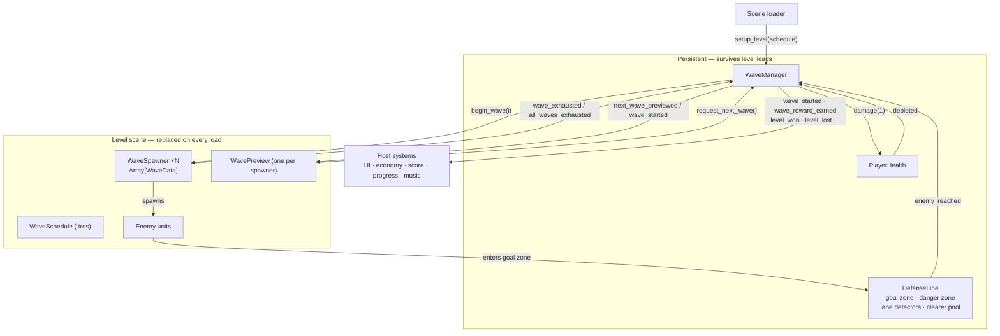

# WaveSystem.md — Reusable Wave System Reference (Godot 4)

A reference for rebuilding the wave system from *Eye of Syn* in another Godot 4 project.
It describes a **cleaned-up design** derived from the working Eye of Syn code. The places
where Eye of Syn differs, and why the clean version is different, are collected in
[Lessons from Eye of Syn](#12-lessons-from-eye-of-syn).

All snippets are GDScript for **Godot 4.4+** (they use typed dictionaries). They were
compile- and behaviour-checked together in a scratch project on Godot 4.6.2.

---

## 1. Overview

A level is a set of **spawners**, each holding an ordered list of **waves**. A wave is a list of
`{unit type, count}` entries. One persistent **WaveManager** sequences every spawner
together: it starts wave *i* on every spawner that has one, waits for all of them to finish
spawning, and then starts wave *i+1* when the next **gap** elapses or the player **calls it
early**. When every spawner has spawned its last wave and no enemy is left alive, the level is
won. A **defense line** behind the lanes takes health when enemies get through and fires
one-shot **lane clearers** for each breach. A **preview** per spawner shows what's coming
next, counts down, and is the button that starts the level or calls the next wave early.



**Design rules**
- **Data in Resources, sequencing in one node.** Waves are `.tres` data. Only the manager decides *when* a wave starts.
- **One gate per transition.** Every wave start goes through `_start_wave`. Every level end goes through `_finish`.
- **The manager is persistent and its setup is idempotent.** `setup_level()` can run any number of times per load without leaking timers or connections.
- **Outward communication is by signals.** The wave system never calls the UI, economy, score or music directly.

---

## 2. Glossary

| Term | Meaning |
|---|---|
| **Wave** | One `WaveData`: the ordered entries one spawner emits for wave index *i*. |
| **Entry** | One `WaveEntry`: a unit type key plus a count. |
| **Spawner** | A node at a lane's mouth that owns `Array[WaveData]` and spawns its pool on request. |
| **Gap** | Seconds from the start of wave *i* to the start of wave *i+1*. A gap of 0 or less means a manual start. |
| **Preview lead time** | How many seconds before a scheduled wave its preview appears. |
| **Early call** | The player starts the next wave before its gap elapses, for a bonus. |
| **Side** | The faction or dimension a spawner and its units belong to (Eye of Syn has two: Purple and Green). |
| **Alive group** | The group every living enemy is in. When it's empty after the final wave, the level is won. |

---

## 3. Data layer

### 3.1 Unit registry: the single source of type keys

A static class. Every other system (spawning, danger scores, previews, editor dropdowns,
presets) looks types up here, so a new unit type is a single edit.

```gdscript
class_name UnitRegistry

const SCENES: Dictionary[String, PackedScene] = {
	"Grunt": preload("res://units/grunt.tscn"),
	"Runner": preload("res://units/runner.tscn"),
}
const DANGER_SCORES: Dictionary[String, int] = {"Grunt": 1, "Runner": 3}
const SPAWN_Y_OFFSETS: Dictionary[String, float] = {"Runner": -4.0}
const PREVIEW_ICONS: Dictionary[String, Texture2D] = {
	"Grunt": preload("res://units/grunt_icon.png"),
	"Runner": preload("res://units/runner_icon.png"),
}
```

> Never `preload()` this registry from an **autoload**. Unit scenes often reference autoloads
> themselves, so the preload becomes a compile-time cycle. Reference it from normal scripts only.

### 3.2 `WaveEntry`

```gdscript
@tool
class_name WaveEntry extends Resource

@export var type: String = "":
	set(value):
		type = value
		emit_changed()
@export_range(0, 99) var count: int = 1:
	set(value):
		count = value
		emit_changed()


func get_danger_score() -> int:
	return count * UnitRegistry.DANGER_SCORES.get(type, 1)


func _get_allowed_types() -> PackedStringArray:
	return PackedStringArray(UnitRegistry.SCENES.keys())


func _validate_property(property: Dictionary) -> void:
	if property.name == "type":
		property.hint = PROPERTY_HINT_ENUM
		property.hint_string = ",".join(_get_allowed_types())
```

- `_validate_property` turns `type` into an Inspector **dropdown built from the registry**, so it can never drift from the real types. The property stays a normal `@export`, so `duplicate()`, saving and undo all behave normally.
- **Per-level type restriction:** subclass the entry and override `_get_allowed_types()`. Waves authored with that subclass only offer that level's units.

```gdscript
@tool
class_name WaveEntryAct1 extends WaveEntry


func _get_allowed_types() -> PackedStringArray:
	return PackedStringArray(["Grunt"])
```

### 3.3 `WaveData`

```gdscript
@tool
class_name WaveData extends Resource

@export var entries: Array[WaveEntry] = []:
	set(value):
		entries = value
		for entry in entries:
			if entry != null and not entry.changed.is_connected(emit_changed):
				entry.changed.connect(emit_changed)
		emit_changed()


func get_counts() -> Dictionary[String, int]:
	var counts: Dictionary[String, int] = {}
	for entry in entries:
		if entry != null and entry.count > 0:
			counts[entry.type] = counts.get(entry.type, 0) + entry.count
	return counts


func get_danger_score() -> int:
	var total := 0
	for entry in entries:
		if entry != null:
			total += entry.get_danger_score()
	return total


func _get_property_list() -> Array[Dictionary]:
	return [{
		"name": "danger_score",
		"type": TYPE_INT,
		"usage": PROPERTY_USAGE_EDITOR | PROPERTY_USAGE_READ_ONLY,
	}]


func _get(property: StringName) -> Variant:
	if property == &"danger_score":
		return get_danger_score()
	return null
```

- **Entry order is spawn order** when the spawner's `is_random` is off. Entries can be reordered by dragging in the Inspector.
- `danger_score` is an **editor-only, read-only, computed** property. It shows how hard a wave is without storing anything.
- The same type may appear twice in a wave (for example "2 Grunts, 1 Runner, 2 Grunts" for ordered spawning). `get_counts()` merges them for display.
- Optional, for tests or procedural levels: a `static func from_counts(counts: Dictionary[String, int]) -> WaveData`. Don't use it for hand-authored levels (see Lessons).

### 3.4 `WaveSchedule`: timing per level

```gdscript
class_name WaveSchedule extends Resource

@export var gaps: Array[float] = []
@export var preview_lead_time: float = 20.0
@export var start_reward: int = 25
@export var early_call_bonus: int = 25
@export var min_gap_after_early_call: float = 5.0
```

The level root exports a `WaveSchedule` and the loader passes it to `setup_level()`.
- `gaps[i]` is the time from the start of wave *i* to the start of wave *i+1*.
- The **wave count comes from the spawners** (the largest `waves.size()`). `gaps` should hold `wave_count - 1` values, and the manager warns if it holds fewer.

---

## 4. Spawner

### Interface

| Kind | Name | Notes |
|---|---|---|
| export | `waves: Array[WaveData]` | The spawner's waves, in order. |
| export | `side: int` | Which faction or dimension its units join. |
| export | `is_random: bool` | Shuffle the pool once per wave. |
| export | `preview: WavePreview` | Optional. The manager binds it on setup. |
| export group | `spawn_offset`, `interval`, `interval_jitter`, `opening_long_gap`, `opening_long_gap_chance` | Timing. |
| method | `get_wave_count() -> int` | |
| method | `get_wave_counts(i) -> Dictionary[String, int]` | Empty for missing or null waves. |
| method | `begin_wave(i)` | Builds the pool and arms the first spawn. |
| method | `stop()` | Clears the pool. Called when the level ends. |
| signal | `wave_exhausted(spawner, wave_index)` | The pool ran dry and more waves follow. |
| signal | `all_waves_exhausted(spawner)` | The pool of its **last** wave ran dry. |
| signal | `unit_spawned(unit)` | Optional hook for statistics or effects. |

Signals carry `self`, so the manager can connect plain methods and guard them with `is_connected`.

### Pool, timing and spawning

```gdscript
func begin_wave(wave_index: int) -> void:
	_current_wave = wave_index
	_pool = _build_pool(waves[wave_index])
	if is_random:
		_pool.shuffle()
	_spawn_timer.start(_opening_delay())


func _build_pool(wave: WaveData) -> Array[String]:
	var pool: Array[String] = []
	if wave == null:
		return pool
	for entry in wave.entries:
		if entry == null:
			continue
		if not UnitRegistry.SCENES.has(entry.type):
			push_warning("%s: unknown unit type '%s'" % [name, entry.type])
			continue
		for _i in entry.count:
			pool.append(entry.type)
	return pool


func _spawn_next() -> void:
	if not _pool.is_empty():
		_spawn(_pool.pop_front())
	if _pool.is_empty():
		_report_exhausted()
	else:
		_spawn_timer.start(interval + randf_range(interval_jitter.x, interval_jitter.y))


func _spawn(type: String) -> void:
	var unit := UnitRegistry.SCENES[type].instantiate() as Enemy
	unit.position = position + spawn_offset + Vector2(0.0, UnitRegistry.SPAWN_Y_OFFSETS.get(type, 0.0))
	unit.add_to_group(Sides.GROUPS[side])
	get_parent().add_child(unit, true)
	unit_spawned.emit(unit)


func _report_exhausted() -> void:
	if _current_wave >= waves.size() - 1:
		all_waves_exhausted.emit(self)
	else:
		wave_exhausted.emit(self, _current_wave)


func _opening_delay() -> float:
	if randf() < opening_long_gap_chance:
		return randf_range(opening_long_gap.x, opening_long_gap.y)
	return randf_range(interval_jitter.x, interval_jitter.y)
```

**Rules that matter:**
- **The pool holds type keys, not scenes.** The key is needed afterwards for spawn offsets and statistics, so never recover it from node names.
- **Exhaustion is never reported synchronously inside `begin_wave`.** Even an empty wave reports after the first timer tick. The manager relies on this: it collects the spawning list *before* calling `begin_wave` on anyone, but an immediate report would still be fragile.
- **Add groups before `add_child`.** Units read their side in `_ready` to choose collision layers, tint and so on.
- `add_child(unit, true)` (`force_readable_name`) produces `Grunt`, `Grunt2`, … with no hand-rolled naming.
- **Opening delay:** the first unit of a wave uses a two-band weighted roll (75% chance of a long gap, otherwise a short one), so lanes don't fire in lockstep. Later units use `interval + jitter`.
- The spawner's `Timer` is created in code. The scene then only needs the `Node2D` and an optional preview child.

### Enemy contract

The wave system needs exactly this from a unit:

```gdscript
class_name Enemy extends Area2D

const ALIVE_GROUP := &"AliveEnemies"


func _ready() -> void:
	add_to_group(ALIVE_GROUP)
	collision_layer = 0
	set_collision_layer_value(Sides.ENEMY_COLLISION_LAYERS[Sides.of(self)], true)


func kill() -> void:
	remove_from_group(ALIVE_GROUP)
	queue_free()
```

- **Join the alive group in the unit's own `_ready`.** Then units that summoners, splitters or revives create also count towards "level not won yet".
- **Leave the group the moment the unit stops being a threat** (start of death), not at `queue_free` after an animation.
- `kill()` is the defense line's "remove without rewards or revives" path. If your units have revive or death effects, keep them out of `kill()`.

---

## 5. Wave Manager

A persistent node that sits **outside** the level scene (for example under the scene loader),
so it survives restarts. Its `PlayerHealth` and `DefenseLine` children are injected as exports.

### 5.1 Interface

| Kind | Name | Notes |
|---|---|---|
| export | `player_health: PlayerHealth`, `defense_line: DefenseLine` | `defense_line` is optional. |
| var | `start_locked: bool` | Tutorials set it to block the Start button. |
| method | `setup_level(schedule)` | Idempotent. Call it once the old level is gone. |
| method | `request_next_wave()` | The preview button: start wave 0 or call the next wave early. |
| method | `call_next_wave_early()` | Bonus, schedule correction, start. |
| method | `start_next_wave()` | Manual or tutorial start. No bonus. |
| method | `debug_force_win()` | Kills everything and goes through the normal win gate. |
| query | `get_wave_count()`, `get_current_wave()`, `has_started()`, `get_seconds_until_next_wave()` | |

### 5.2 Idempotent setup

```gdscript
func setup_level(schedule: WaveSchedule) -> void:
	_next_wave_timer.stop()
	_preview_timer.stop()
	_schedule = schedule
	_gaps = schedule.gaps.duplicate()
	_current_wave = -1
	_all_spawned = false
	_level_over = false
	player_health.reset()
	if defense_line != null:
		defense_line.reset()
	_collect_spawners()
	_warn_about_unwinnable_setup()
	next_wave_previewed.emit(0)


func _collect_spawners() -> void:
	_spawners.clear()
	_total_waves = 0
	_unfinished_spawners = 0
	for node in get_tree().get_nodes_in_group(WaveSpawner.GROUP):
		var spawner := node as WaveSpawner
		if spawner == null or spawner.is_queued_for_deletion():
			continue
		_spawners.append(spawner)
		_total_waves = maxi(_total_waves, spawner.get_wave_count())
		if spawner.get_wave_count() > 0:
			_unfinished_spawners += 1
		if not spawner.wave_exhausted.is_connected(_on_spawner_wave_exhausted):
			spawner.wave_exhausted.connect(_on_spawner_wave_exhausted)
			spawner.all_waves_exhausted.connect(_on_spawner_finished)
		if spawner.preview != null:
			spawner.preview.bind(self, spawner)
```

- `_gaps` is a **runtime copy**. Early calls change it, and the `.tres` must never be changed.
- **Spawners with zero waves are not counted** towards completion. Otherwise they would block the win forever.
- **Skip spawners queued for deletion.** During a restart the old level may still be in the tree for a frame.
- Persistent children (timers, health, defense line) are connected **once**, in `_ready`. Only per-level nodes are connected in `setup_level`, and those connections are guarded.

### 5.3 The single wave-start gate

```gdscript
func _start_wave(wave_index: int) -> void:
	if _level_over or wave_index <= _current_wave or wave_index >= _total_waves:
		return
	_next_wave_timer.stop()
	_preview_timer.stop()
	_current_wave = wave_index
	if wave_index > 0:
		wave_reward_earned.emit(_schedule.start_reward)

	_spawning_current_wave.clear()
	for spawner in _spawners:
		if wave_index < spawner.get_wave_count():
			_spawning_current_wave.append(spawner)
	for spawner in _spawning_current_wave.duplicate():
		spawner.begin_wave(wave_index)

	wave_started.emit(wave_index)
	if _spawning_current_wave.is_empty():
		wave_spawning_finished.emit(wave_index)
	_schedule_wave_after(wave_index)


func _schedule_wave_after(wave_index: int) -> void:
	if wave_index >= _gaps.size() or _gaps[wave_index] <= 0.0:
		return
	var gap := _gaps[wave_index]
	_next_wave_timer.start(gap)
	var preview_delay := gap - _schedule.preview_lead_time
	if preview_delay > 0.0:
		_preview_timer.start(preview_delay)
	else:
		_preview_next_wave()
```

- **The index only moves forward.** That makes a double click, a timer firing at the same moment as an early call, or a stray tutorial call harmless.
- **Stop both timers first**, then re-arm them for the new wave. This drops a schedule left over from a previous wave after an early call.
- **Build the spawning list, then start the spawners.** A spawner that reports instantly can't empty a half-built list.
- If the lead time is longer than the gap, the preview shows immediately.
- A manual gap (0 or less) arms nothing: no timer and no preview. The next wave waits for `start_next_wave()`.

### 5.4 Start button and early calls

```gdscript
func request_next_wave() -> void:
	if has_started():
		call_next_wave_early()
	elif not start_locked:
		_start_wave(0)


func call_next_wave_early() -> void:
	var next := _current_wave + 1
	if _level_over or next >= _total_waves:
		return
	_keep_absolute_schedule(next)
	wave_called_early.emit(next)
	wave_reward_earned.emit(_schedule.early_call_bonus)
	_start_wave(next)


func _keep_absolute_schedule(called_wave: int) -> void:
	if called_wave >= _gaps.size() or _gaps[called_wave] <= 0.0:
		return
	var seconds_early := _next_wave_timer.time_left
	_gaps[called_wave] = maxf(_gaps[called_wave] - seconds_early, _schedule.min_gap_after_early_call)
```

- **Absolute schedule:** calling wave *k* early by *t* seconds shortens the gap after it by *t*, so wave *k+1* still arrives when it originally would have. Calling early buys bonus resources, not a shorter level. If you'd rather keep the relative pacing, delete `_keep_absolute_schedule`.
- `min_gap_after_early_call` keeps the shortened gap above zero. Without the clamp, a large early call turns the following wave into a **manual** wave.
- `time_left` has to be read **before** `_start_wave` stops the timer.
- An early call pays **two rewards**: `early_call_bonus` and the normal `start_reward`. Both are separate, named values.

### 5.5 Completion, win and loss

```gdscript
func _on_spawner_finished(spawner: WaveSpawner) -> void:
	_mark_done_spawning(spawner)
	_unfinished_spawners -= 1
	if _unfinished_spawners == 0:
		_all_spawned = true
		all_waves_spawned.emit()
		_check_for_win()


func _mark_done_spawning(spawner: WaveSpawner) -> void:
	if not _spawning_current_wave.has(spawner):
		return
	_spawning_current_wave.erase(spawner)
	if _spawning_current_wave.is_empty():
		wave_spawning_finished.emit(_current_wave)


func _check_for_win() -> void:
	if _level_over or not _all_spawned:
		return
	if get_tree().get_nodes_in_group(Enemy.ALIVE_GROUP).is_empty():
		_finish(true)
	else:
		get_tree().create_timer(WIN_CHECK_INTERVAL, false).timeout.connect(_check_for_win)


func _finish(won: bool) -> void:
	if _level_over:
		return
	_level_over = true
	_next_wave_timer.stop()
	_preview_timer.stop()
	for spawner in _spawners:
		if is_instance_valid(spawner):
			spawner.stop()
	if won:
		level_won.emit()
	else:
		level_lost.emit()
```

- A spawner with fewer waves than the level reports `all_waves_exhausted` early. That counts both as "done with this wave" and as "finished", and later waves skip it.
- `create_timer(t, false)` makes the win poll **pause-aware**, so the level can't end behind the pause menu.
- A stale poll from a previous load is harmless, because each check re-reads the current state through the guards. If you'd rather avoid polling, have the enemy base emit a signal when it leaves the alive group and check then.
- **Everything goes through `_finish`:** natural wins, debug wins and losses. It runs **once per load**, stops the spawners, and only then emits.
- `_ready` connects `player_health.depleted` to `_finish.bind(false)`, and the defense line's `enemy_reached` to:

```gdscript
func _on_enemy_reached(enemy: Enemy) -> void:
	enemy.kill()
	if not _level_over:
		player_health.damage(1)
```

The `_level_over` guard stops a straggler that crosses the line after a forced win from costing health.

---

## 6. Signal contract

| Signal | Emitted when | Typical listeners |
|---|---|---|
| `next_wave_previewed(i)` | On setup (`i = 0`), and `preview_lead_time` before each scheduled wave | Previews |
| `wave_started(i)` | Inside `_start_wave`, after the spawners have begun | Wave-number label, previews (hide), music intensity, "game has started" hooks such as resource timers on `i == 0` |
| `wave_called_early(i)` | Player called wave `i` early | Score (early-call bonus) |
| `wave_reward_earned(amount)` | Each wave start after the first, and each early call | Economy |
| `wave_spawning_finished(i)` | Every spawner taking part in wave `i` has emptied its pool | Music ("calm once few enemies remain"), tutorials |
| `all_waves_spawned` | Every spawner with waves has emitted its last unit | Tutorials, UI |
| `level_won` | Once, after the final enemy dies (or a debug win) | **Progress save first**, then the score screen |
| `level_lost` | Once, when health reaches 0 | Lose screen (which also owns pausing) |
| `PlayerHealth.health_changed(cur, max)` | Every reset or damage | Health labels for every side, score ("lives lost") |
| `DefenseLine.threat_changed(side, threatened)` | Every danger-zone check | Off-screen warning (for example glowing the inactive side's view) |

Signal listeners run in **connection order**. If the progress save and the "Next level" screen
both listen to `level_won`, connect the save first, or have one progression listener that saves
and then opens the screen.

---

## 7. Wave preview UI

One preview per spawner, placed at the lane's mouth. Each one has:
- a single **button**: *Start* before wave 0 and *Call early* after that;
- a **countdown** ring and number;
- a **breakdown** of the next wave's units, shown on hover.

```gdscript
func bind(manager: WaveManager, spawner: WaveSpawner) -> void:
	if _manager == manager:
		return
	_manager = manager
	_spawner = spawner
	manager.next_wave_previewed.connect(_on_next_wave_previewed)
	manager.wave_started.connect(_on_wave_started)
	button.pressed.connect(manager.request_next_wave)
	button.mouse_entered.connect(_show_breakdown)
	button.mouse_exited.connect(breakdown.hide)
	_hide_preview()


func _on_next_wave_previewed(wave_index: int) -> void:
	_wave_index = wave_index
	visible = not _spawner.get_wave_counts(wave_index).is_empty()
	var counting_down := _manager.has_started()
	countdown_bar.visible = counting_down
	countdown_label.visible = counting_down
	countdown_bar.max_value = maxf(_manager.get_seconds_until_next_wave(), 0.01)


func _process(_delta: float) -> void:
	if not visible or not countdown_bar.visible:
		return
	var remaining := _manager.get_seconds_until_next_wave()
	countdown_bar.value = countdown_bar.max_value - remaining
	countdown_label.text = str(ceili(remaining))


func _show_breakdown() -> void:
	for row in breakdown.get_children():
		row.queue_free()
	var counts := _spawner.get_wave_counts(_wave_index)
	for type in counts:
		var row := breakdown_row_scene.instantiate() as BreakdownRow
		breakdown.add_child(row)
		row.setup(UnitRegistry.PREVIEW_ICONS.get(type), counts[type], Sides.TINTS[_spawner.side])
	breakdown.show()
```

- **The countdown reads the manager's real timer** (`get_seconds_until_next_wave`), so it can't drift from the real start or show the lead time when the real gap is shorter.
- **The breakdown is built from data:** one `BreakdownRow` per type in the wave, with the icon from `UnitRegistry.PREVIEW_ICONS`. There are no hand-placed rows per unit type. `add_child` comes **before** `setup()` if the row uses `@onready`.
- **A preview hides itself** when its spawner has nothing in that wave. For wave 0, at least one spawner must have units, or nothing can show the Start button (`_warn_about_unwinnable_setup` is a good place to check this as well).
- `bind` is idempotent (`_manager == manager`). Connections to a preview are removed automatically when the preview is freed with its level.
- `set_interactive(enabled)` turns off the button and mouse filter for previews on an **inactive side**. In a culled-layer setup, invisible Controls still receive mouse input.
- **Visual extras** in Eye of Syn: a rounded `Panel` whose `StyleBoxFlat.bg_color` is brightened in linear space on hover (`glow_panel.gd`), and a `NinePatchRect` frame resized to the breakdown panel whenever the layout changes (`PreviewVisualBorder.gd`). For the frame to work, the panel grows leftwards (`grow_horizontal = BEGIN`) with its right edge pinned after `reset_size()`.

---

## 8. Defense line

A persistent `Node2D` under the manager. It holds a **goal zone** (the base), a **danger zone**
just in front of it, one **`LaneDetector` per lane**, and a pool of **`LaneClearer`s** (lawnmowers).

### 8.1 Player health

```gdscript
class_name PlayerHealth extends Node

signal health_changed(current: int, maximum: int)
signal depleted

@export var max_health: int = 20

var current: int


func reset() -> void:
	current = max_health
	health_changed.emit(current, max_health)


func damage(amount: int = 1) -> void:
	if current <= 0:
		return
	current = maxi(current - amount, 0)
	health_changed.emit(current, max_health)
	if current == 0:
		depleted.emit()
```

`depleted` fires **once**. Health is a **single shared pool** across all sides.

### 8.2 Lane detectors and the clearer pool

```gdscript
class_name LaneDetector extends Area2D

signal breached(detector: LaneDetector, side: int)

var _tripped_sides: Dictionary[int, bool] = {}


func rearm() -> void:
	_tripped_sides.clear()


func _on_area_entered(area: Area2D) -> void:
	if area is not Enemy:
		return
	var side := Sides.of(area)
	if side < 0 or _tripped_sides.has(side):
		return
	_tripped_sides[side] = true
	breached.emit(self, side)
```

```gdscript
func reset() -> void:
	_idle_clearers.clear()
	for side in Sides.GROUPS.size():
		for slot in clearers_per_side:
			_idle_clearers.append(_clearer_for(side, slot))
	for detector in _detectors:
		detector.rearm()


func _clearer_for(side: int, slot: int) -> LaneClearer:
	var clearer_name := "Clearer_%d_%d" % [side, slot]
	var clearer := get_node_or_null(clearer_name) as LaneClearer
	if clearer == null:
		clearer = clearer_scene.instantiate() as LaneClearer
		clearer.name = clearer_name
		clearer.side = side
		add_child(clearer)
	clearer.park(clearer_home)
	return clearer


func _on_lane_breached(detector: LaneDetector, side: int) -> void:
	for clearer in _idle_clearers:
		if clearer.side == side:
			_idle_clearers.erase(clearer)
			clearer.launch(detector.global_position)
			return
```

- **One detector per lane, one trip per side.** A breach on one side doesn't disarm the lane for the other.
- **Clearers are charges per side, not per lane.** Eye of Syn has 7 lanes and 3 clearers per side, so the first three breaches on a side are covered. If you want "one mower per lane" instead, give each detector its own clearer.
- **The pool rebuilds itself.** `reset()` re-finds each slot by name, or recreates it if something freed it. Clearers are **parked** (hidden, monitoring off) after their run and never freed, because they live under a persistent node.
- `clearer.side` is set **before** `add_child`, so the clearer's `_ready` sets its collision mask to that side's enemy layer and its **visibility layer** (recursively, because cull masks are per CanvasItem). That matters because it lives outside the level subtrees that would normally be stamped.
- A launched clearer teleports to the detector, moves right at `speed`, kills enemies (through `kill()`) of **its side only** on `area_entered`, and parks itself after `max_distance`. Don't query `get_overlapping_areas()` right after the teleport: overlaps aren't updated until the next physics step, and `area_entered` covers that case anyway.

### 8.3 Goal zone and danger zone

- **Goal zone:** on `area_entered` with an `Enemy`, it emits `enemy_reached(enemy)`, and the manager kills the enemy and deals 1 damage. The mask covers every side's enemy layer.
- **Danger zone:** a `Timer` (every 2 s) checks `get_overlapping_areas()` and emits `threat_changed(side, threatened)` for each side. The UI decides what to show; Eye of Syn glows the picture-in-picture view of the **inactive** dimension when *its* enemies are close.

---

## 9. Multiple sides (factions or dimensions)

Eye of Syn runs two copies of every level at once (Purple and Green) and keeps them apart
with groups, collision layers and canvas visibility bits. To make that generic, put it in one
static table:

```gdscript
class_name Sides

const GROUPS: Array[StringName] = [&"SideA", &"SideB"]
const ENEMY_COLLISION_LAYERS: Array[int] = [4, 5]
const VISIBILITY_BITS: Array[int] = [1 << 1, 1 << 2]
const TINTS: Array[Color] = [Color("9b42df"), Color("0b8700")]


static func of(node: Node) -> int:
	for side in GROUPS.size():
		if node.is_in_group(GROUPS[side]):
			return side
	return -1
```

- Spawners export `side`. Units join `GROUPS[side]` before entering the tree.
- Clearers, previews and labels look up their layer, visibility bit and tint here, never from a hard-coded "is_green".
- **The manager is side-agnostic.** It sequences every spawner regardless of side, so all sides share wave indices and timing.
- With a single side, `GROUPS` has one entry, and everything above still works.

---

## 10. Editor tooling (optional, high value)

1. **Type-restricted entries and danger scores:** see §3.2–3.3. The spawner can also expose a read-only `wave_danger_scores` string ("W1: 4, W2: 9 …") the same way as `danger_score`, to show the difficulty curve at a glance.
2. **Wave table:** an inert `@tool` `WaveTableHost` node exports only `search_root: NodePath`. An `EditorInspectorPlugin` whose `_can_handle(object)` returns `object is WaveTableHost` adds a custom panel in `_parse_begin`. The panel shows **every spawner in the edited scene** as a grid (waves as rows, types as columns, danger as the last column), with Markdown export. **The spawners' `waves` arrays stay the only source of truth.**
3. **IO layer** (`RefCounted`, static functions, **no `class_name`**, so editor code never registers a global class in exports):
   - Find spawners with `root.find_children("*", "WaveSpawner", true, false)` (`owned = false` includes instanced sub-scenes).
   - Make surgical cell writes that keep the authored spawn order:

```gdscript
static func set_count(wave: WaveData, type: String, new_count: int) -> void:
	var matches: Array[int] = []
	for i in wave.entries.size():
		if wave.entries[i] != null and wave.entries[i].type == type:
			matches.append(i)

	if matches.is_empty():
		if new_count > 0:
			var entry := WaveEntry.new()
			entry.type = type
			entry.count = new_count
			wave.entries.append(entry)
	elif new_count <= 0:
		for i in range(matches.size() - 1, -1, -1):
			wave.entries.remove_at(matches[i])
	else:
		wave.entries[matches[0]].count = new_count
		for i in range(matches.size() - 1, 0, -1):
			wave.entries.remove_at(matches[i])

	wave.entries = wave.entries
```

   - **Undo:** take a snapshot (clone) of `waves` before and after, then call `undo_redo.create_action(name, UndoRedo.MERGE_ENDS, spawner)`, `add_do_property(spawner, "waves", after)` and `add_undo_property(spawner, "waves", before)`. Leave the *value* out of the action name, so dragging a spin box merges into one undo step. Pass the spawner as the context so the right scene is marked as changed.
   - The last line (`wave.entries = wave.entries`) re-runs the setter, so `changed` fires.
4. **Presets:** named JSON snapshots of a scene's waves (`<scene folder>/WavePresets/<preset>/<scene>.json`), each containing `{format, scene, saved, root, spawners: {path_from_root: {is_random, waves: [[{type, count}]]}}}`.
   - Spawners are matched **by path from the scene root**.
   - Unknown types and unmatched spawners are reported as warnings, not errors.
   - Applying a preset is **one** undoable action.
   - Put a `.gdignore` in `WavePresets/` so presets are never imported or exported.
   - With `WaveSchedule` as a Resource, a preset can store the schedule's path or its gaps the same way.

---

## 11. Integration points: what the host project supplies

| Host responsibility | How it connects |
|---|---|
| **Scene loader** | Owns the persistent manager. After the old level is freed and the new one is added, it calls `wave_manager.setup_level(level.wave_schedule)`, deferred by a frame. It must **never** call `_ready()` manually. |
| **Level** | Exports `wave_schedule: WaveSchedule`, holds the spawners (with their previews), and sets `start_locked` / calls `start_next_wave()` for tutorials. |
| **Economy** | `wave_reward_earned(amount)` → add currency (on every side, if each side has its own). |
| **Score** | `wave_called_early`, `health_changed`, `level_won` → score and rank. |
| **Progression** | `level_won` → record the level as beaten **before** any "Next" screen reads progress. |
| **UI** | `wave_started` → wave number label. `level_lost` → lose screen + pause. `threat_changed` → off-screen warning. On a side switch → `preview.set_interactive()` for each side. |
| **Music** | `wave_started` (the last *N* waves are "intense") and `wave_spawning_finished` (calm down once fewer than *X* enemies are alive). |
| **Debug** | A key → `debug_force_win()`. If you need forced ranks, the score module applies them. The wave system knows nothing about ranks. |
| **Enemies** | Implement the `Enemy` contract (§4). |

---

## 12. Lessons from Eye of Syn

What the original does, the risk, and how the clean design avoids it.

| Eye of Syn | Risk | Clean design |
|---|---|---|
| `WaveManager.wave_delays` is set by each level script from `wave2StartTime…wave6StartTime` exports on the level root. | The wave count is capped by how many exports exist, the timing is split across two places, and the preset tool has to know the export names. | `WaveSchedule` Resource on the level, passed to `setup_level`. |
| An early call does `wave_delays[next] -= time_left` on the **exported** array. | Mutates configuration. A large early call makes the gap ≤ 0, which silently turns the next wave into a manual one. | A runtime copy plus a `min_gap_after_early_call` clamp. |
| An early call adds blood in `_on_call_early_wave_requested` **and** in `_start_wave` (25 + 25). | A double reward that looks accidental. | Two named values: `early_call_bonus` and `start_reward`. |
| `Global.gameIsStarted` is set by the preview button. `Global.start_wave_1()` runs on **every spawn tick**. | Global state written by UI, and per-spawn work that only needs to happen once. | `has_started()` and `wave_started(0)`. |
| Wave count = `wave_delays.size() + 1`. A spawner with **more** waves never finishes. A spawner with **zero** waves never reports. | The level can't be won. | Wave count from the spawners, zero-wave spawners excluded, warnings on mismatch. |
| Some levels build waves in code (`set_waves_from_dicts`) and others in `.tres`. | The Wave Table editor and presets show Inspector data that code overwrites at runtime. | **One authoring path:** Inspector/`.tres`. `from_counts` is for tests and procedural levels only. |
| Preview icons and labels are matched by **substring of node names**. Spawn Y offsets are found by substring of the spawned node's name. | Breaks on renames and overlapping names (the `Occulum` ⊂ `SpinalOcculum` trap). | Type key carried in the pool. Icons from `UnitRegistry.PREVIEW_ICONS`. |
| The preview has 10 hand-placed rows, one per unit type. | Every new unit type means editing the scene. | Rows generated from the wave's counts. |
| The preview's own `NextWaveTimer` always counts down `preview_lead_time`. | Shows the wrong time when the gap is shorter than the lead time. | The countdown reads the manager's real timer. |
| `WavePreview` finds its side with `get_parent().get_parent().get_parent().get_node("UILayer")`. `ZombieSpawner` has `Level0-1` name checks. | Fragile tree walks and level-specific branches in shared code. | `side` exported on the spawner and passed in through `bind`. |
| Lane detectors are shared by both dimensions and disable themselves on the first breach from **either** side. | A purple breach disarms that lane for green. | Detectors trip once **per side**. |
| Lane detectors live under the persistent `WaveManager`, and originally nothing re-enabled them (fixed 2026-11-03: `setup_level` now calls `rearm()`). | After a restart, every lane breached in an earlier attempt had no mower protection for the rest of the session. | `DefenseLine.reset()` calls `rearm()` on every detector. |
| A mower calls `get_overlapping_areas()` immediately after teleporting. | Overlap data is stale for a physics frame. | Rely on `area_entered`. |
| A mower kills on `area_entered` even while parked. | Kills by accident if the home position overlaps a lane. | Kills only while launched. |
| `_lose()` searches the parent's children for a name containing `"LevelSwitcher"` and pauses the tree. | Name coupling, and the wave system owns pausing. | Emit `level_lost`. The UI shows the screen and pauses. |
| `PlayerHealth.damage` emits `depleted` on every hit at or below 0. | `_lose` can run several times. | Emits once, clamped at 0. |
| `_wave_previews: Array = [Node]` initial value. | A stray placeholder element (overwritten in setup, but misleading). | Typed, empty arrays. |
| Two identical mower scenes (`LawnMower.tscn`, `lawn_mower.tscn`). | Edits land in the wrong one. | One scene, exported on the defense line. |
| `WaveEntry` declares `type`/`count` as plain vars and builds the dropdown in `_get_property_list`. | `duplicate()` and storage behave unusually (the editor tool had to clone by hand). | `@export` + `_validate_property`. |

What Eye of Syn got right, and the clean design keeps:
- One gate each for wave start and level end.
- A persistent manager with idempotent setup.
- Signals carrying wave indices.
- A self-rebuilding, pooled clearer set.
- A pause-aware win poll.
- A forced win that goes through the normal win path.
- Waves as `.tres` data with computed danger scores, edited through an undo-aware table tool that never stores a second copy.

---

## 13. Rebuild checklist and test plan

### Build order
1. `Sides`, `UnitRegistry`, and the `Enemy` base (with alive group and `kill()`).
2. `WaveEntry` (+ per-level subclasses), `WaveData`, `WaveSchedule`.
3. `WaveSpawner`. Test it on its own: `begin_wave(0)` spawns the right counts, then reports.
4. `PlayerHealth`, `WaveManager`. Connect the loader so it calls `setup_level` on every load and restart.
5. `DefenseLine` with `LaneDetector`, `LaneClearer`, goal zone and danger zone.
6. `WavePreview` + `BreakdownRow`. Connect the side switch to `set_interactive`.
7. Host listeners: economy, score, progress, UI, music.
8. Optional: danger-score fields, `WaveTableHost` + inspector plugin, presets.

### Automated smoke test (headless `SceneTree` script)
Build the nodes in code (spawners with `WaveData.from_counts`, a manager with a `PlayerHealth`
child, short gaps such as `[0.6, 0.6]` and 0.02 s spawn intervals), then assert:

- the dropdown hint comes from `_get_allowed_types()`;
- `danger_score` and `set_count` (duplicates collapse, order is kept, a count of 0 removes the type);
- the wave count comes from the spawners, and the wave-0 preview is emitted on setup;
- `start_locked` blocks the Start button, and a second `_start_wave(0)` is ignored;
- an early call pays the bonus, then the start reward, and clamps the following gap;
- a later wave auto-starts, every wave emits `wave_spawning_finished`, and there's no win while enemies are alive;
- the level is won after the last enemy dies, even with a spawner that has no waves;
- running `setup_level` again on the same scene resets state with no duplicate-connection errors;
- the level is lost exactly once, and no waves start after it ends.

Run it with
`<godot_console.exe> --headless --path <project> -s res://test_waves.gd` and exit with
`quit(1)` on failure. Add a watchdog timer so a signal that never fires fails the test instead of hanging it.

### Manual play checks
1. Leak one enemy: exactly **one** clearer launches, on that enemy's side, and health drops by 1 in every side's label. At 0 health, the lose screen appears once.
2. Call a wave early: the reward arrives, and the following wave still arrives at its original time (or after the minimum gap).
3. Hover the preview: one row per unit type, with the side's tint. A spawner that's empty for that wave shows no preview.
4. Pause during the final wave with zero enemies left: there's no win until you unpause.
5. **Restart torture:** restart three times mid-wave (with clearers launched, a preview visible and enemies alive). Check for no errors or duplicate connections, full health, clearers home and visible, previews showing wave 0, and the wave label reset.
6. A debug win mid-wave: one win, progress is saved, the spawners stop, and stragglers don't cost health.
